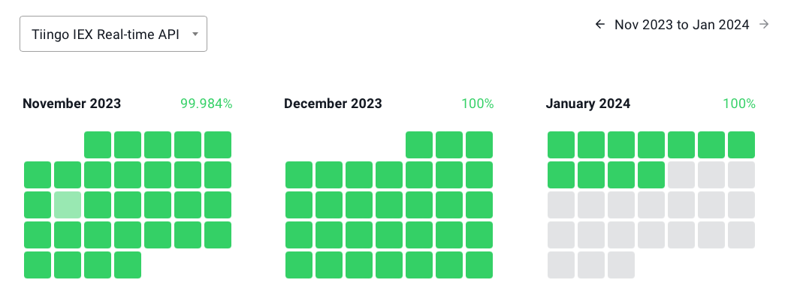

= Tiingo supported
:icons: font
:source-highlighter: rouge
:sourcefile: ../../samples/integration.kt
:jbake-date: 2024-01-12
:intro: Recently Tiingo support was added to roboquant. This blog highlights some of the benefits of this market-data provider.

== Intro
_Roboquant_ recently added basic support for Tiingo, a market data provider. Roboquant supports both historical- and live-datafeeds from Tiingo.

To understand why Tiingo support was added, it is good to first understand what a market-data provider should ideally provide to a retail algo-trader.

== Market Data provider
If there is one area in algo-trading for retail traders that quickly can become expensive, it is access to good market data. Good in this context means:

- High quality.
+
For example, you don't want stock prices that didn't incorporate a split and look liked they halved in price while, in fact, they didn't.
And although it might be possible to clean up historical data manually, this is very difficult to do with real-time data.

- Fair price
+
You don't want to pay thousands of dollars per month for your data, since this would severally reduce the profit margins for most retail traders.

- Good selection
+
A good selection of assets and asset classes, so you are not limited to just trade a few.

- High availability
+
Especially when live trading, you want to be able to rely on the data being available. If your market data provider is down, there is not much else to do but wait or liquidate all your open positions. Both can lead to much higher risk profiles or unforeseen losses.

- Low latency
+
You don't want only to have to access to 15-minute delayed stock prices. Unfortunately, this is what many cheaper subscriptions provide due to distribution limitations of many stock exchanges.

As it turns out, it is not easy to find market data providers that meet all the above criteria. But Tiingo might be an exception.

== Tiingo

For sure, the mission statement of Tiingo is very different from what you expect from a fintech company.

" Tiingo was formed with the mission that Love is the ideal way to conduct ourselves and our businesses."
-- Tiingo website

But let's see how this holds up when we compare their offering against the earlier established criteria.

=== High quality ✓
It is challenging to establish a measurable metric on data quality. One way is to check posts on social media and see if other people are facing data quality issues.

Overall, Tiingo seems to be highly regarded and often recommended by others. Only their beta products sometimes have some quality issues. Like always, it is highly recommended to do your own research.

Tiingo also takes extra measures to detect issues in historical data and fix them.

"Tiingo's End-of-Day prices use a proprietary error checking framework to help clean data feeds and also help catch missing corporate actions (splits, dividends, and exchange listing changes)."
-- Tiingo website

One important thing to note is that the published realtime US stock prices are those from the IEX exchange only. So the spread of a single stock is typically larger than the spread of all exchanges consolidated.

This is just a decision made to keep the subscription fee low, and not a data quality issue. But nonetheless, something to be aware of.

=== Fair price ✓
There is a free account with 1GB of data access. And for $30 per month, you get a more generous amount of data among others.

The main differences are that the free account is more limited in the number of unique symbols, API calls, and bandwidth. See https://www.tiingo.com/about/pricing[Tiingo pricing] for an overview of all the differences.

The API supports returning the result in CSV format as a way to optimize bandwidth for retrieving historical data. That way, you can do more within your monthly limit. The _roboquant_ implementation takes full advantage of this option.

====
Suppose you average 2% monthly growth, which would make you an excellent trader. And you don't want your market-data cost to be more than 25% of your total profit.

That implies that you require  `($30 / 0.25) * (1 / 0.02) =  *$6000* buying power`

Anything less than that $6000, and your subscription fee would become more than 25% of your overall profit margin.
====

=== Good selection ✓
Tiingo provides access to US Equities, ETFs, Mutual Funds, Chinese A-Shares, Forex and crypto. All are included in a single subscription.

Next to that, they also provide access to non-market data, like financial news and fundamental data.

=== High availability ✓
Tiingo publishes their uptime online, so you can easily https://uptime.tiingo.com[check] it for yourself.

Below is a screenshot of the uptime of their real-time IEX API. The average is 99.984%, and as you can see, there is only one-day with a percentage lower than 100%.

=== Low latency ✓
The IEX real-time stock prices are delivered with only 15ms delay as mandated by the IEX exchange. And if you pay $500 a month to the IEX exchange, this 15ms delay will be removed all together. Although personally, I don't see many use-cases where 15ms delay for retail trading makes a difference.

Of course, you should add the delay from your machine to the Tiingo server. But for most retail algo-traders, this is still fast enough.

Also reassuring that Tiingo has chosen a professional datacenter location close to IEX Exchange. And if you want minimal delay, you could choose to rent a server nearby (Equinix data centers in the New York region)

== Usage
Using Tiingo in _roboquant_ is straight forward. The standard `Feed` api can be used to retrieve historical and live data.

The following snippet shows how to retrieve historical candlestick prices from Tiingo:
[source, kotlin,indent=0]
----
include::{sourcefile}[tag=tiingohistoric]
----

Tiingo also provides real-time stock data with only 15ms delay from the IEX exchange.
You can either subscribe to a subset of the available stocks, or receive all the stocks:

[source, kotlin,indent=0]
----
include::{sourcefile}[tag=tiingolive]
----

Please note that this can generate a lot of data. The market data will be available as `PriceQuote` in the `Event` object.

You can read more about the integration in the xref:../tutorial/integration.adoc#__tiingo[tutorial]
