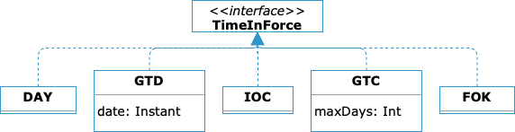

= Orders
:source-highlighter: rouge
:icons: font
:jbake-date: 2020-04-01
:sourcefile: ../../samples/orders.kt

== Order Types
Roboquant version 3 comes out of the box with support for limit orders. These orders can be created, updated or cancelled.

****
An order always refers to a single asset, including advanced order types like BracketOrders. The reason for putting this restriction in place is that real brokers only have limited support for multi-asset orders, and this could lead to issues that are only discovered during live trading. Additionally, it makes back testing unpredictable if the price is only known for one of the assets.
****

== Creating Orders
The `Trader` used during a `run` is responsible for creating the orders. This can be based on the received signals from the `Strategy`, but can also be done for other reasons (like for example cyclic portfolio re-balancing).

An example on how to convert a list of signals into a list of orders:

[source, kotlin,indent=0]
----
include::{sourcefile}[tag=orders]
----

NOTE: There is no explicit notion of BUY or SELL order in _roboquant_. A BUY order is just an order with a positive size, and a SELL order has a negative size. But other than that, they are equal and created the same way.

== TIF (Time In Force)
TIF sets an execution policy for an order, defining under what conditions the order remains valid. There are two types of TIF:

. Time based, defining how long the order remains valid. Two common ones are GTD (Good Till Day) and GTC (Good Till Cancelled)
. Fill based, defining under which fill conditions the order stays valid. A common one if FOK (Fill Or Kill)

The following diagram shows the time in force policies that are available out of the box:

The default TIF for orders in _roboquant_, if none is explicitly specified, is GTC (Good Till Cancelled).
All TIF policies only become active once an `CreateOrder` has been `ACCEPTED` (so it's not any more in the `INITIAL` state).

== Own order logic
Although you typically would use the `run` method to handle method invocations on the various components, you can also invoke these methods directly from your own code.

For example, if you want to place an order, you can directly invoke the `Broker.place` method:

[source, kotlin,indent=0]
----
include::{sourcefile}[tag=manualOrder]
----
